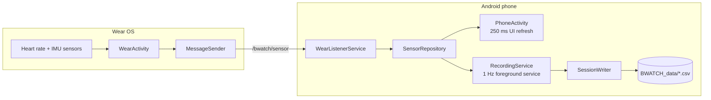
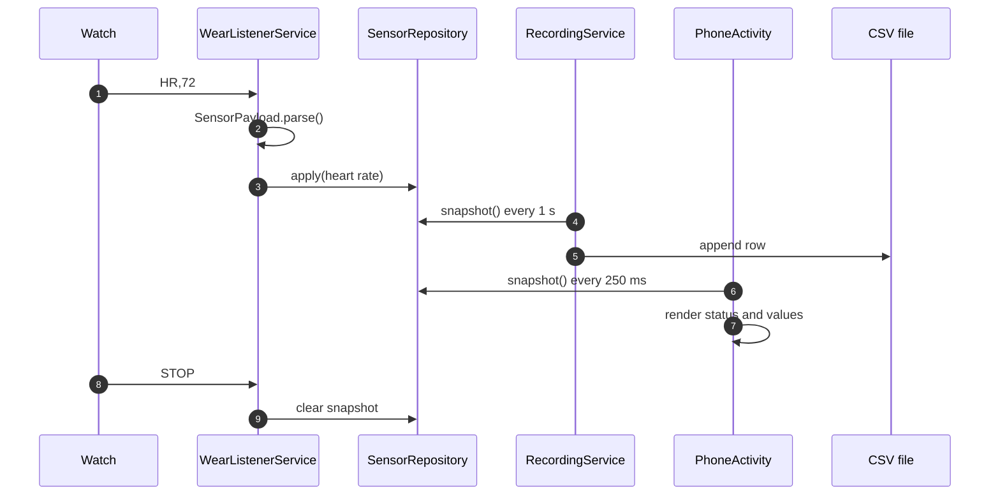

# ⌚️ BWATCH

[](https://github.com/HarryVasanth/BWATCH/actions/workflows/ci.yml)
[](LICENSE)

BWATCH is an Android Wear research application for studying motivation, engagement, and emotional states during binge-watching. A Wear OS app streams heart rate, gyroscope, and accelerometer samples to a paired phone. The phone records the latest values once per second to a CSV file for offline analysis.

## Study

### Abstract

The popularity of internet-distributed TV entertainment services, such as Netflix, has transformed TV consumption behavior. Currently, the level of control viewers have over their TV experiences, along with the release of complete seasons at once, are some of the factors that stimulate the so-called binge-watching phenomenon (the consumption of several episodes of a program in a single sitting). Most of binge-watching studies have focused on viewers’ habits and health effects. This paper presents a study that relates to viewers’ behaviors and moods. It was carried out with 13 young participants at their home, watching online content, collecting physiological, inertial, and self-reported data. We identify and compare binge-watching with non-binge-watching behaviors. Our results suggest that while viewers recur to online serial entertainment in pursuit of leisure related needs, such as relaxation, relief from boredom and escapism, the act of binge-watching tends to make them feel rather unsatisfied with no change in Arousal. Nevertheless, in binge-watching the Positive Affect increases while the Negative decreases. Moreover, watching a single episode only, tends to result in increased arousal and but not necessarily in increased satisfaction. This preliminary finding can be the starting point of fruitful future investigations on unpacking further motives and nuances from this outcome.

### Publication

**To Binge or not to Binge: Viewers’ Moods and Behaviors During the Consumption of Subscribed Video Streaming**

> - DOI: https://doi.org/10.1007/978-3-030-65736-9_33
> - ISBN (Print): 978-3-030-65735-2
> - ISBN (Online): 978-3-030-65736-9

<details>
<summary>📎 Citation</summary>

> Cabral, Diogo, Deborah Castro, Jacob M. Rigby, Harry Vasanth, Mónica
> S. Cameirão, Sergi Bermúdez I. Badia, and Valentina Nisi. "To Binge or
> not To Binge: viewers’ moods and behaviors during the consumption of
> subscribed video streaming." In International Conference on
> Entertainment Computing, pp. 369-381. Cham: Springer International
> Publishing, 2020.

</details>

## Architecture



The two apps communicate through the Wearable Message API. Messages are intentionally small, validated on receipt, and carry no personal identifiers.



### Module layout

```text
BWATCH/
├── mobile/                  Phone app and recorder
│   └── src/main/java/com/harry/bwatch/
│       ├── PhoneActivity.java
│       ├── RecordingService.java
│       ├── data/            Pure-Java protocol, repository, CSV code
│       └── services/        WearableListenerService
├── wear/                    Wear OS app
│   └── src/main/java/com/harry/bwatch/
│       ├── WearActivity.java
│       ├── MessageSender.java
│       └── WearProtocol.java
└── .github/workflows/       Build, test and lint CI
```

The `data` package has no Android dependencies, so protocol parsing, snapshot merging, and CSV formatting are covered by fast JVM unit tests.

## Sensor protocol

| Payload | Meaning |
| --- | --- |
| `HR,72` | Heart rate in beats per minute, `0` means no contact |
| `GYRO,1.250,-4.500,0.000` | Gyroscope in degrees per second |
| `ACC,0.100,0.200,9.810` | Linear acceleration in m/s² |
| `STOP` | Watch ended the session; clear the phone snapshot |

Messages use the path `/bwatch/sensor` and UTF-8 payloads. Incoming payloads are limited to 128 characters. Unknown types, wrong column counts, non-finite numbers, and out-of-range values are discarded. Coordinates are bounded to ±1,000,000 to reject corrupt values without affecting real sensor ranges. Motion samples are rate-limited to 5 Hz on the watch; the phone records one snapshot per second, so forwarding at the full sensor rate would waste battery and Bluetooth bandwidth.

## Recorded data

The recorder writes one row per second while at least one sensor channel has reported in the last five seconds:

```csv
date,time,hr,gyro_x,gyro_y,gyro_z,acc_x,acc_y,acc_z
2026-11-20,14:03:01.004,72,1.25,-4.50,0.00,0.10,0.20,9.81
2026-11-20,14:03:02.006,73,1.27,-4.48,0.01,0.12,0.19,9.80
```

- One file per recording session, named `bWatch_yyyyMMdd_HHmmss.csv`.
- The header is written once; reopening an existing file does not duplicate it.
- Timestamps use the phone's local time zone.
- Numbers always use a dot decimal separator, independent of phone language.
- Rows pause while the watch is disconnected and resume when data arrives again. Heart-rate and motion freshness are tracked separately.
- A heart-rate value of `0` means the watch reports no contact. It is stored in the CSV, but the dashboard shows **No heart rate** instead of **Connected**.
- Rows are flushed immediately, keeping data safe if the app is killed, at a negligible cost of one flush per second.

Files live in the app-specific external directory and are removed when the app is uninstalled:

```text
/sdcard/Android/data/com.harry.bwatch/files/BWATCH_data/
```

Retrieve them for analysis with:

```bash
adb pull /sdcard/Android/data/com.harry.bwatch/files/BWATCH_data/
```

## Setup

### Requirements

- JDK 21
- Android SDK Platform 37 and Build Tools 37.0.0
- Android Studio or the command-line SDK tools
- A Wear OS 2+ watch paired with an Android 6.0+ phone

### Build

```bash
export ANDROID_HOME="$HOME/Library/Android/sdk"   # adjust for your SDK location
./gradlew testDebugUnitTest lintDebug assembleDebug
```

The debug APKs are generated at:

```text
mobile/build/outputs/apk/debug/mobile-debug.apk
wear/build/outputs/apk/debug/wear-debug.apk
```

Install both APKs. This Gradle setup builds the phone and watch apps independently; the phone APK does not embed the watch APK, so `adb install` of the phone APK alone does not install the watch app:

```bash
adb install -r mobile/build/outputs/apk/debug/mobile-debug.apk
adb -s <watch-serial> install -r wear/build/outputs/apk/debug/wear-debug.apk
```

### Record a session

1. Pair the watch and phone in the Wear OS companion app.
2. Launch BWATCH on the watch. Grant the body sensors permission when prompted.
3. Launch BWATCH on the phone. Grant the notification permission on Android 13+.
4. Keep the watch app in the foreground; it holds the screen on while recording.
5. Tap **STOP** on the watch and the exit icon on the phone, or use the notification's stop action.
6. Pull the `BWATCH_data` directory for analysis.

## Permissions and privacy

| Permission | App | Why |
| --- | --- | --- |
| `BODY_SENSORS` | Wear | Read heart rate |
| `POST_NOTIFICATIONS` | Phone | Show the ongoing recording notification (Android 13+) |
| `FOREGROUND_SERVICE`, `FOREGROUND_SERVICE_SPECIAL_USE` | Phone | Keep recording while the screen is off |
| `WAKE_LOCK` | Phone | Keep the CPU awake between one-second samples |

The phone app has no internet permission and performs no network requests. It does not request storage, location, or Bluetooth permissions. Recordings stay in app-specific storage, `android:allowBackup` is disabled, and uninstalling the app deletes the data. Data is not encrypted by the app; rely on device storage encryption and the study's data-handling procedure.

The foreground service is declared as `specialUse` because continuous research data collection does not fit the media, location, or health exercise categories.

## Testing

```bash
./gradlew testDebugUnitTest
```

Unit tests cover payload validation, locale-independent CSV output, per-channel freshness, snapshot merging, and session-file lifecycle. Lint and a debug assembly run in CI:

```bash
./gradlew lintDebug assembleDebug
```

## Continuous integration

The GitHub Actions workflow builds both modules on every push and pull request, uploads the debug APKs, and runs unit tests and Android Lint. Dependabot checks Gradle and GitHub Actions dependencies weekly.

## Limitations

- Validated on the JVM and by compilation only in this repository; a physical phone and Wear OS watch are still required for end-to-end verification.
- The watch app must remain in the foreground. Wear OS pauses sensor listeners when the activity is not visible.
- OEM battery optimizations can still stop the phone service; exempt BWATCH from battery optimization during long sessions if needed.
- The wake lock has a 24-hour safety timeout, matching the expected maximum session length.
- If the watch does not provide a heart-rate sensor, motion data is still recorded and the phone shows **No heart rate**.
- The phone clock is the timestamp source, so correct phone time is required.

## Contributing

See [contributors.txt](contributors.txt). Please run `./gradlew testDebugUnitTest lintDebug` before opening a pull request.

## License

[MIT](LICENSE)
